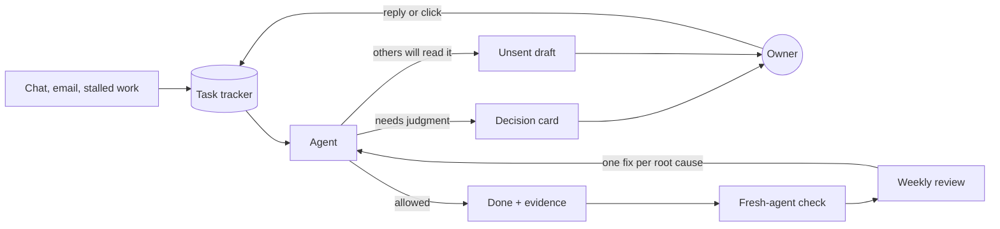

# How I work with AI agents

## The model in one paragraph

Every piece of work is an issue in one task tracker. Agents find new work in
chat, email and stalled issues several times a day, and create or update
issues for it. For each issue an agent either does the work end to end (when
the action is inside its authority), writes a decision card for me (when my
judgment is needed), or tracks it (when someone else owns it). Anything other
people will read is left as an unsent draft for me. Every issue ends each turn
in a state that says whose turn it is. A separate agent checks every issue an
agent closed. Once a week the agents read my corrections, find the root cause
of each one, and fix it in exactly one place.

## The measure of success

The main metric is **my interventions per delivered result**: how many times I
had to step in (correct, retry, remind, re-explain) for each thing the agents
delivered. It is read together with the number of results the agents
delivered on their own initiative, so that doing less never counts as
progress.
