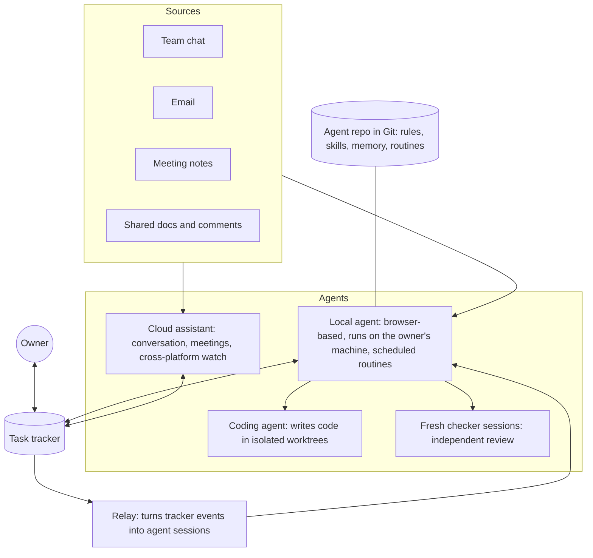

# Architecture

## Components

**Task tracker.** The single ledger. Every deliverable is one issue. Issues are
assigned to the owner and delegated to an agent, so the owner sees everything
and the agent knows it is responsible. Comments on an issue are the
conversation between the owner and the agents.

**Local agent.** A browser-based agent running on the owner's machine with the
owner's logged-in sessions. It reaches systems that are only available from
inside the company network, runs scheduled routines (collectors, watches,
checks), executes issues, and starts helper sessions. Most of the work runs
here.

**Cloud assistant.** A hosted assistant that the owner talks to directly and
that sees cloud-visible signals (conversation, meeting notes). It writes what
it learns into the tracker and reads its own write back. Its suggestions are
advice: the executing agent weighs them on the merits.

**Relay.** A small service that listens to tracker events (an issue delegated
to the agent, a comment, a reaction) and opens an agent session for the issue.
It lets the owner start work with a comment or one click, and lets agents
start sessions on other issues. It must ignore events the agent itself caused,
or the agent will trigger itself in a loop.

**Coding agent.** Used for every change to code. It works in a separate Git
worktree. A second, read-only run reviews the frozen diff before merge. See
[Agent-written code](../workflows/coding.md).

**Fresh checker sessions.** Sub-sessions that did not do the work and do not
share its context. They check Done issues and review diffs.

**Agent repository.** A Git repository that holds the agents' rules file,
persona, skills, memory and routine definitions. Agents commit their own
changes to it. Git gives every rule change a diff, an author and an undo.

## How one piece of work flows

1. A colleague asks for something in chat.
2. The next collector window sees the message, checks that it is a real ask
   addressed to the owner, runs the duplicate check, and creates an issue (or
   comments on the existing one). The issue gets a parent: the bigger piece of
   work it serves.
3. The issue starts an agent session through the relay, or the collector's own
   session works it.
4. The agent decides the outcome: do it (whitelisted), prepare a decision card
   (needs judgment), or track it (someone else owns it).
5. If a reply is needed, the agent leaves it as an unsent draft in the chat
   tool and sets the issue to In Review with a first line saying what the owner
   must do.
6. The owner edits and sends the draft. The reply watch sees that the draft
   was sent, records it and moves the issue on.
7. When the deliverable is complete, the agent posts evidence and sets Done. A
   fresh session checks it the next day.
